# LAPORAN RESMI PRAKTIKUM KOMUNIKASI DATA & JARINGAN KOMPUTER

## MODUL 3: CURTAIN PROTOCOL — SHIBUYA INCIDENT (SOAL 11–20)

* **Kelompok:** K-60
* **Prefix IP:** `192.241.x.x`
* **Domain Resmi:** `jujutsu.k60.com` / `jujutsu.k-60.com`

---

## Daftar Alamat IP Infrastruktur (Soal 11–20)

| Nama Node | Jaringan | Alamat IP | Peran Layanan | Image |
| ----- | ----- | ----- | ----- | ----- |
| **Utahime** | Network 1 (DMZ) | `192.241.1.2/24` | DNS Master (BIND9) | `debinet` |
| **Shoko** | Network 1 (DMZ) | `192.241.1.3/24` | DNS Slave (BIND9) | `debinet` |
| **Gojo** | Network 1 (DMZ) | `192.241.1.4/24` | Public Reverse Proxy (Nginx) | `debinet` |
| **Geto** | Network 4 (Data Center) | `192.241.4.11/24` | Internal Load Balancer (Nginx) | `debinet` |
| **Maki** | Network 4 (Data Center) | `192.241.4.12/24` | Worker Frontend 1 (Nginx + PHP-FPM) | `debinet` |
| **Panda** | Network 4 (Data Center) | `192.241.4.13/24` | Worker Frontend 2 (Nginx + PHP-FPM) | `debinet` |
| **Nanami** | Network 4 (Data Center) | `192.241.4.14/24` | Worker API Utama 1 (Weight 3) | `debinet` |
| **Todo** | Network 4 (Data Center) | `192.241.4.15/24` | Worker API Utama 2 (Weight 1) | `debinet` |
| **Kirara** | Network 4 (Data Center) | `192.241.4.16/24` | Worker API Cadangan (`backup`) | `debinet` |
| **Yaga (Yoga)** | Network 4 (Data Center) | `192.241.4.17/24` | Database Master (MariaDB) | `debinet` |
| **Inumaki** | Network 4 (Data Center) | `192.241.4.18/24` | Database Slave (MariaDB) | `debinet` |
| **Itadori** | Network 2 (Divisi A) | `192.241.2.10/24` | Client DHCP Pool 1 | `alpinet` |
| **Kugisaki** | Network 3 (Divisi B) | `192.241.3.99/24` | Client Fixed Address | `alpinet` |
| **Rusakabe (Kusakabe)** | Network 3 (Divisi B) | `192.241.3.10/24` | Client Short Lease (1800s) & Benchmark | `alpinet` |

---

## Soal 11: Konfigurasi DNS Master (Utahime) & DNS Slave (Shoko)

### Deskripsi
Membangun layanan penamaan domain `jujutsu.k60.com` menggunakan BIND9 dengan **Utahime** (`192.241.1.2`) sebagai DNS Master dan **Shoko** (`192.241.1.3`) sebagai DNS Slave. Mengatur SOA record, NS delegasi untuk kedua server, serta menerapkan `allow-transfer` dari Master ke Slave dan menguji sinkronisasi otomatis saat nomor serial dinaikkan.

### 1. Script `/root` pada Server (Utahime & Shoko)

#### A. Node **Utahime** (`/root/soal11.sh` & `/root/soal11_naik_serial.sh`)
```bash
cat << 'EOF' > /root/soal11.sh
#!/bin/bash
ip addr add 192.241.1.2/24 dev eth0 2>/dev/null || true
ip link set eth0 up
ip route replace default via 192.241.1.1

if ! command -v named >/dev/null 2>&1; then
    echo "nameserver 192.168.122.1" > /etc/resolv.conf
    apt-get update && apt-get install -y bind9 bind9utils dnsutils
fi

mkdir -p /etc/bind/jarkom

cat << 'EOT' > /etc/bind/named.conf.local
zone "jujutsu.k60.com" {
    type master;
    file "/etc/bind/jarkom/jujutsu.k60.com";
    allow-transfer { 192.241.1.3; };
    also-notify { 192.241.1.3; };
};

zone "jujutsu.k-60.com" {
    type master;
    file "/etc/bind/jarkom/jujutsu.k-60.com";
    allow-transfer { 192.241.1.3; };
    also-notify { 192.241.1.3; };
};
EOT

cat << 'EOT' > /etc/bind/jarkom/jujutsu.k60.com
$TTL    604800
@       IN      SOA     jujutsu.k60.com. root.jujutsu.k60.com. (
                        2026101501      ; Serial
                        604800          ; Refresh
                        86400           ; Retry
                        2419200         ; Expire
                        604800 )        ; Negative Cache TTL
;
@       IN      NS      ns1.jujutsu.k60.com.
@       IN      NS      ns2.jujutsu.k60.com.
ns1     IN      A       192.241.1.2
ns2     IN      A       192.241.1.3
@       IN      A       192.241.1.4
EOT

cat << 'EOT' > /etc/bind/jarkom/jujutsu.k-60.com
$TTL    604800
@       IN      SOA     jujutsu.k-60.com. root.jujutsu.k-60.com. (
                        2026101501      ; Serial
                        604800          ; Refresh
                        86400           ; Retry
                        2419200         ; Expire
                        604800 )        ; Negative Cache TTL
;
@       IN      NS      ns1.jujutsu.k-60.com.
@       IN      NS      ns2.jujutsu.k-60.com.
ns1     IN      A       192.241.1.2
ns2     IN      A       192.241.1.3
@       IN      A       192.241.1.4
EOT

named-checkconf
service named restart || service bind9 restart
EOF

chmod +x /root/soal11.sh
/root/soal11.sh
```

Script menaikkan nomor serial (`/root/soal11_naik_serial.sh`):
```bash
cat << 'EOF' > /root/soal11_naik_serial.sh
#!/bin/bash
sed -i 's/2026101501/2026101502/g' /etc/bind/jarkom/jujutsu.k60.com
sed -i 's/2026101501/2026101502/g' /etc/bind/jarkom/jujutsu.k-60.com
rndc reload || service named reload || service bind9 reload
EOF

chmod +x /root/soal11_naik_serial.sh
/root/soal11_naik_serial.sh
```

#### B. Node **Shoko** (`/root/soal11.sh`)
```bash
cat << 'EOF' > /root/soal11.sh
#!/bin/bash
ip addr add 192.241.1.3/24 dev eth0 2>/dev/null || true
ip link set eth0 up
ip route replace default via 192.241.1.1

if ! command -v named >/dev/null 2>&1; then
    echo "nameserver 192.168.122.1" > /etc/resolv.conf
    apt-get update && apt-get install -y bind9 bind9utils dnsutils
fi

cat << 'EOT' > /etc/bind/named.conf.local
zone "jujutsu.k60.com" {
    type slave;
    masters { 192.241.1.2; };
    file "/var/lib/bind/jujutsu.k60.com";
};

zone "jujutsu.k-60.com" {
    type slave;
    masters { 192.241.1.2; };
    file "/var/lib/bind/jujutsu.k-60.com";
};
EOT

named-checkconf
service named restart || service bind9 restart
EOF

chmod +x /root/soal11.sh
/root/soal11.sh
```

### 2. Konfigurasi File Non-Root (`/etc/bind/*`)
File konfigurasi sistem BIND9 diletakkan di luar `/root`, yaitu pada:
* `/etc/bind/named.conf.local` (di Utahime dan Shoko)
* `/etc/bind/jarkom/jujutsu.k60.com` (di Utahime)
* `/var/lib/bind/jujutsu.k60.com` (direktori sinkronisasi otomatis milik user `bind` di Shoko)

### 3. Cara Pengujian & Hasil Verifikasi

1. **Di Shoko (Cek File Zona Hasil Transfer):**
   ```bash
   ls -l /var/lib/bind/
   ```
   **Hasil:**
   ```text
   total 8
   -rw-r--r-- 1 bind bind 351 Oct 15 04:57 jujutsu.k-60.com
   -rw-r--r-- 1 bind bind 342 Oct 15 04:57 jujutsu.k60.com
   ```
   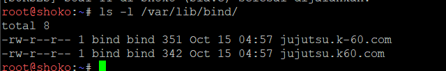

2. **Di Client Itadori (Query SOA ke Master & Slave):**
   ```sh
   dig @192.241.1.2 jujutsu.k60.com SOA +short
   dig @192.241.1.3 jujutsu.k60.com SOA +short
   ```
   **Hasil:**
   ```text
   jujutsu.k60.com. root.jujutsu.k60.com. 2026101502 604800 86400 2419200 604800
   jujutsu.k60.com. root.jujutsu.k60.com. 2026101502 604800 86400 2419200 604800
   ```
   *(Nomor serial pada Utahime dan Shoko terbukti sama-sama naik ke `2026101502`).*
   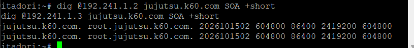

---

## Soal 12: A Record, CNAME (`www`), Reverse DNS (`PTR`), & Forwarder

### Deskripsi
Memetakan A record `jujutsu.k60.com` ke **Gojo** (`192.241.1.4`), menambahkan CNAME `www` yang merujuk ke domain utama, membuat zona Reverse DNS (`1.241.192.in-addr.arpa`) untuk melacak IP Gojo kembali ke domain resminya, serta mengaktifkan DNS Forwarder ke `192.168.122.1`.

### 1. Script `/root` pada Server (Utahime & Shoko)

#### A. Node **Utahime** (`/root/soal12.sh`)
```bash
cat << 'EOF' > /root/soal12.sh
#!/bin/bash
cat << 'EOT' > /etc/bind/named.conf.options
options {
    directory "/var/cache/bind";
    forwarders {
        192.168.122.1;
    };
    dnssec-validation no;
    allow-query { any; };
    auth-nxdomain no;
    listen-on-v6 { any; };
};
EOT

cat << 'EOT' > /etc/bind/named.conf.local
zone "jujutsu.k60.com" {
    type master;
    file "/etc/bind/jarkom/jujutsu.k60.com";
    allow-transfer { 192.241.1.3; };
    also-notify { 192.241.1.3; };
};

zone "jujutsu.k-60.com" {
    type master;
    file "/etc/bind/jarkom/jujutsu.k-60.com";
    allow-transfer { 192.241.1.3; };
    also-notify { 192.241.1.3; };
};

zone "1.241.192.in-addr.arpa" {
    type master;
    file "/etc/bind/jarkom/1.241.192.in-addr.arpa";
    allow-transfer { 192.241.1.3; };
    also-notify { 192.241.1.3; };
};
EOT

cat << 'EOT' > /etc/bind/jarkom/jujutsu.k60.com
$TTL    604800
@       IN      SOA     jujutsu.k60.com. root.jujutsu.k60.com. (
                        2026101503      ; Serial
                        604800          ; Refresh
                        86400           ; Retry
                        2419200         ; Expire
                        604800 )        ; Negative Cache TTL
;
@       IN      NS      ns1.jujutsu.k60.com.
@       IN      NS      ns2.jujutsu.k60.com.
ns1     IN      A       192.241.1.2
ns2     IN      A       192.241.1.3
@       IN      A       192.241.1.4
www     IN      CNAME   jujutsu.k60.com.
EOT

cat << 'EOT' > /etc/bind/jarkom/1.241.192.in-addr.arpa
$TTL    604800
@       IN      SOA     jujutsu.k60.com. root.jujutsu.k60.com. (
                        2026101503      ; Serial
                        604800          ; Refresh
                        86400           ; Retry
                        2419200         ; Expire
                        604800 )        ; Negative Cache TTL
;
@       IN      NS      ns1.jujutsu.k60.com.
@       IN      NS      ns2.jujutsu.k60.com.
4       IN      PTR     jujutsu.k60.com.
EOT

named-checkconf
named-checkzone jujutsu.k60.com /etc/bind/jarkom/jujutsu.k60.com
named-checkzone 1.241.192.in-addr.arpa /etc/bind/jarkom/1.241.192.in-addr.arpa
service named restart || service bind9 restart
EOF

chmod +x /root/soal12.sh
/root/soal12.sh
```

#### B. Node **Shoko** (`/root/soal12.sh`)
```bash
cat << 'EOF' > /root/soal12.sh
#!/bin/bash
cat << 'EOT' > /etc/bind/named.conf.options
options {
    directory "/var/cache/bind";
    forwarders {
        192.168.122.1;
    };
    dnssec-validation no;
    allow-query { any; };
    auth-nxdomain no;
    listen-on-v6 { any; };
};
EOT

cat << 'EOT' > /etc/bind/named.conf.local
zone "jujutsu.k60.com" {
    type slave;
    masters { 192.241.1.2; };
    file "/var/lib/bind/jujutsu.k60.com";
};

zone "jujutsu.k-60.com" {
    type slave;
    masters { 192.241.1.2; };
    file "/var/lib/bind/jujutsu.k-60.com";
};

zone "1.241.192.in-addr.arpa" {
    type slave;
    masters { 192.241.1.2; };
    file "/var/lib/bind/1.241.192.in-addr.arpa";
};
EOT

named-checkconf
service named restart || service bind9 restart
EOF

chmod +x /root/soal12.sh
/root/soal12.sh
```

### 2. Konfigurasi File Non-Root
* `/etc/bind/named.conf.options` (konfigurasi `forwarders { 192.168.122.1; };`)
* `/etc/bind/jarkom/1.241.192.in-addr.arpa` (zona PTR untuk `192.241.1.4`)

### 3. Cara Pengujian & Hasil Verifikasi
Diuji dari client **Itadori**:
```sh
dig @192.241.1.2 jujutsu.k60.com +short
dig @192.241.1.2 www.jujutsu.k60.com
dig @192.241.1.2 -x 192.241.1.4 +short
ping -c 3 google.com
```
**Hasil Output:**
* `dig @192.241.1.2 jujutsu.k60.com +short` $\rightarrow$ `192.241.1.4`
* `dig @192.241.1.2 www.jujutsu.k60.com` $\rightarrow$ Menampilkan `www.jujutsu.k60.com. IN CNAME jujutsu.k60.com.` dan `jujutsu.k60.com. IN A 192.241.1.4`
* `dig @192.241.1.2 -x 192.241.1.4 +short` $\rightarrow$ `jujutsu.k60.com.`
* `ping -c 3 google.com` $\rightarrow$ `3 packets transmitted, 3 received, 0% packet loss`

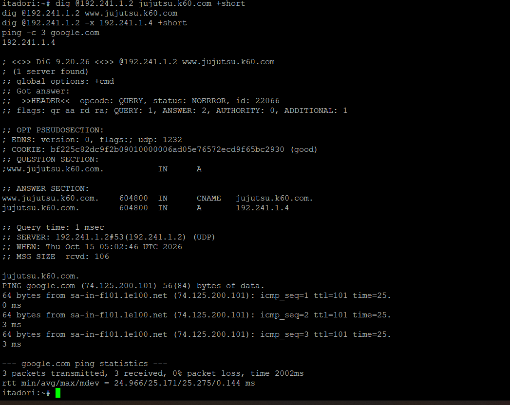

---

## Soal 13: Replikasi Database MariaDB Master–Slave (Yaga/Yoga & Inumaki)

### Deskripsi
Mengonfigurasi MariaDB pada **Yaga/Yoga** (`192.241.4.17`) sebagai DB-Master dan **Inumaki** (`192.241.4.18`) sebagai DB-Slave untuk database `db_shibuya_k60` dan tabel `request_logs`. Mengaktifkan `log-bin` dan `server-id`, memberikan hak akses remote untuk seluruh node di Network 4 (`192.241.4.%`), serta membuktikan replikasi secara *realtime*.

### 1. Script `/root` pada Server (Yaga/Yoga & Inumaki)

#### A. Node **Yaga / Yoga** (`/root/soal13.sh`)
```bash
cat << 'EOF' > /root/soal13.sh
#!/bin/bash
ip addr add 192.241.4.17/24 dev eth0 2>/dev/null || true
ip link set eth0 up
ip route replace default via 192.241.4.1

if ! command -v mariadbd >/dev/null 2>&1 && ! command -v mysqld >/dev/null 2>&1; then
    echo "nameserver 192.168.122.1" > /etc/resolv.conf
    apt-get update && apt-get install -y mariadb-server mariadb-client
fi

mkdir -p /var/log/mysql /run/mysqld
chown -R mysql:mysql /var/log/mysql /run/mysqld /var/lib/mysql
chmod 755 /var/log/mysql /run/mysqld

cat << 'EOT' > /etc/mysql/mariadb.conf.d/99-master.cnf
[mysqld]
bind-address = 0.0.0.0
server-id = 1
log_bin = /var/log/mysql/mysql-bin.log
binlog_do_db = db_shibuya_k60
EOT

service mariadb restart

mariadb -u root -e "STOP SLAVE;" 2>/dev/null || true
mariadb -u root -e "RESET MASTER;"

mariadb -u root << 'EOT'
CREATE DATABASE IF NOT EXISTS db_shibuya_k60;
USE db_shibuya_k60;

CREATE TABLE IF NOT EXISTS request_logs (
    id INT AUTO_INCREMENT PRIMARY KEY,
    worker_name VARCHAR(50),
    client_ip VARCHAR(50),
    created_at TIMESTAMP DEFAULT CURRENT_TIMESTAMP
);

CREATE USER IF NOT EXISTS 'repl'@'%' IDENTIFIED BY 'replpass';
GRANT REPLICATION SLAVE, REPLICATION CLIENT ON *.* TO 'repl'@'%';

CREATE USER IF NOT EXISTS 'jujutsu'@'192.241.4.%' IDENTIFIED BY 'jujutsupass';
GRANT ALL PRIVILEGES ON db_shibuya_k60.* TO 'jujutsu'@'192.241.4.%';
FLUSH PRIVILEGES;
EOT

mariadb -u root -e "SHOW MASTER STATUS\G"
EOF

chmod +x /root/soal13.sh
/root/soal13.sh
```

#### B. Node **Inumaki** (`/root/soal13.sh`)
```bash
cat << 'EOF' > /root/soal13.sh
#!/bin/bash
ip addr add 192.241.4.18/24 dev eth0 2>/dev/null || true
ip link set eth0 up
ip route replace default via 192.241.4.1

if ! command -v mariadbd >/dev/null 2>&1 && ! command -v mysqld >/dev/null 2>&1; then
    echo "nameserver 192.168.122.1" > /etc/resolv.conf
    apt-get update && apt-get install -y mariadb-server mariadb-client
fi

mkdir -p /var/log/mysql /run/mysqld
chown -R mysql:mysql /var/log/mysql /run/mysqld /var/lib/mysql
chmod 755 /var/log/mysql /run/mysqld

cat << 'EOT' > /etc/mysql/mariadb.conf.d/99-slave.cnf
[mysqld]
bind-address = 0.0.0.0
server-id = 2
relay-log = /var/log/mysql/mysql-relay-bin.log
log_bin = /var/log/mysql/mysql-bin.log
binlog_do_db = db_shibuya_k60
read_only = 1
EOT

service mariadb restart

mariadb -u root << 'EOT'
STOP REPLICA;
RESET REPLICA ALL;
CREATE DATABASE IF NOT EXISTS db_shibuya_k60;
USE db_shibuya_k60;
CREATE TABLE IF NOT EXISTS request_logs (
    id INT AUTO_INCREMENT PRIMARY KEY,
    worker_name VARCHAR(50),
    client_ip VARCHAR(50),
    created_at TIMESTAMP DEFAULT CURRENT_TIMESTAMP
);
EOT

MASTER_STATUS=$(mariadb -h 192.241.4.17 -u repl -preplpass -e "SHOW MASTER STATUS\G" 2>/dev/null)
LOG_FILE=$(echo "$MASTER_STATUS" | awk '/File:/ {print $2}')
LOG_POS=$(echo "$MASTER_STATUS" | awk '/Position:/ {print $2}')

if [ -z "$LOG_FILE" ]; then
    LOG_FILE=${1:-mysql-bin.000001}
    LOG_POS=${2:-328}
fi

mariadb -u root << EOT
CHANGE MASTER TO
    MASTER_HOST='192.241.4.17',
    MASTER_USER='repl',
    MASTER_PASSWORD='replpass',
    MASTER_LOG_FILE='$LOG_FILE',
    MASTER_LOG_POS=$LOG_POS;
START REPLICA;
EOT

sleep 1
mariadb -u root -e "SHOW SLAVE STATUS\G" | grep -E "Slave_IO_Running|Slave_SQL_Running|Last_Error"
EOF

chmod +x /root/soal13.sh
/root/soal13.sh
```

### 2. Konfigurasi File Non-Root
* `/etc/mysql/mariadb.conf.d/99-master.cnf` (pada Yaga/Yoga)
* `/etc/mysql/mariadb.conf.d/99-slave.cnf` (pada Inumaki)
* `/var/log/mysql/mysql-bin.log` (binary log milik user `mysql:mysql`)

### 3. Cara Pengujian & Hasil Verifikasi
1. **Insert data baru pada Master (Yaga/Yoga):**
   ```bash
   mariadb -u root -D db_shibuya_k60 -e "INSERT INTO request_logs (worker_name, client_ip) VALUES ('tes-yaga', '192.241.4.17');"
   ```
   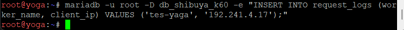

2. **Periksa hasil replikasi pada Slave (Inumaki):**
   ```bash
   mariadb -u root -D db_shibuya_k60 -e "SELECT * FROM request_logs;"
   ```
   **Hasil Output di Inumaki:**
   ```text
   +----+-------------+---------------+---------------------+
   | id | worker_name | client_ip     | created_at          |
   +----+-------------+---------------+---------------------+
   |  1 | tes-yaga    | 192.241.4.17  | 2026-10-15 05:11:15 |
   +----+-------------+---------------+---------------------+
   ```
   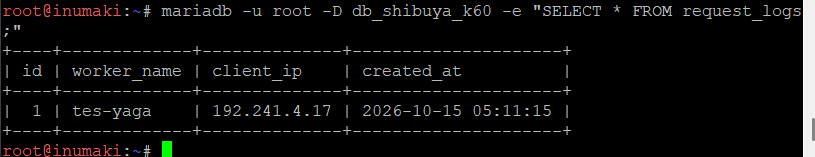

---

## Soal 14: Konfigurasi Worker Frontend (Maki, Panda) & Worker API (Nanami, Todo, Kirara)

### Deskripsi
Memasang Nginx dan PHP-FPM pada **Maki** (`192.241.4.12`) dan **Panda** (`192.241.4.13`) untuk menyajikan halaman web frontend yang menampilkan hostname masing-masing, serta menyiapkan layanan API pencatat log ke database Yaga pada **Nanami** (`.4.14`), **Todo** (`.4.15`), dan **Kirara** (`.4.16`). Membatasi akses langsung dari klien: worker frontend hanya menerima trafik dari **Gojo** (`192.241.1.4`), dan worker API hanya menerima trafik dari **Geto** (`192.241.4.11`).

### 1. Script `/root` pada Server

#### A. Node **Maki** & **Panda** (`/root/soal14.sh` — Worker Frontend)
```bash
cat << 'EOF' > /root/soal14.sh
#!/bin/bash
HOST=$(hostname)
if [ "$HOST" = "maki" ]; then
    ip addr add 192.241.4.12/24 dev eth0 2>/dev/null || true
elif [ "$HOST" = "panda" ]; then
    ip addr add 192.241.4.13/24 dev eth0 2>/dev/null || true
fi
ip link set eth0 up
ip route replace default via 192.241.4.1

if ! command -v nginx >/dev/null 2>&1 || ! dpkg -l | grep -q php-fpm; then
    echo "nameserver 192.168.122.1" > /etc/resolv.conf
    apt-get update && apt-get install -y nginx php-fpm curl
fi

for svc in $(ls /etc/init.d/php*-fpm 2>/dev/null); do $svc start; done
PHP_SOCK=$(find /run/php/ -name "php*-fpm.sock" | head -n 1)

mkdir -p /var/www/jujutsu
cat << 'EOT' > /var/www/jujutsu/index.php
<?php
echo "Halo dari Frontend Worker: " . gethostname() . "\n";
?>
EOT

cat << EOT > /etc/nginx/sites-available/jujutsu
server {
    listen 80;
    server_name jujutsu.k60.com www.jujutsu.k60.com jujutsu.k-60.com www.jujutsu.k-60.com;

    root /var/www/jujutsu;
    index index.php index.html;

    allow 192.241.1.4;
    deny all;

    location / {
        try_files \$uri \$uri/ /index.php?\$query_string;
    }

    location ~ \.php$ {
        include snippets/fastcgi-php.conf;
        fastcgi_pass unix:$PHP_SOCK;
    }
}
EOT

ln -sf /etc/nginx/sites-available/jujutsu /etc/nginx/sites-enabled/jujutsu
rm -f /etc/nginx/sites-enabled/default
nginx -t && service nginx restart
EOF

chmod +x /root/soal14.sh
/root/soal14.sh
```

#### B. Node **Nanami**, **Todo**, & **Kirara** (`/root/soal14.sh` — Worker API)
```bash
cat << 'EOF' > /root/soal14.sh
#!/bin/bash
HOST=$(hostname)
if [ "$HOST" = "nanami" ]; then
    ip addr add 192.241.4.14/24 dev eth0 2>/dev/null || true
elif [ "$HOST" = "todo" ]; then
    ip addr add 192.241.4.15/24 dev eth0 2>/dev/null || true
elif [ "$HOST" = "kirara" ]; then
    ip addr add 192.241.4.16/24 dev eth0 2>/dev/null || true
fi
ip link set eth0 up
ip route replace default via 192.241.4.1

if ! command -v nginx >/dev/null 2>&1 || ! dpkg -l | grep -q php-mysql; then
    echo "nameserver 192.168.122.1" > /etc/resolv.conf
    apt-get update && apt-get install -y nginx php-fpm php-mysql mariadb-client curl
fi

for svc in $(ls /etc/init.d/php*-fpm 2>/dev/null); do $svc start; done
PHP_SOCK=$(find /run/php/ -name "php*-fpm.sock" | head -n 1)

mkdir -p /var/www/api
cat << 'EOT' > /var/www/api/index.php
<?php
header('Content-Type: application/json');
$worker = gethostname();
$client_ip = $_SERVER['HTTP_X_REAL_IP'] ?? $_SERVER['REMOTE_ADDR'];

$mysqli = @new mysqli("192.241.4.17", "jujutsu", "jujutsupass", "db_shibuya_k60");
$db_status = "connected";
if ($mysqli->connect_error) {
    $db_status = "error: " . $mysqli->connect_error;
} else {
    $stmt = $mysqli->prepare("INSERT INTO request_logs (worker_name, client_ip) VALUES (?, ?)");
    if ($stmt) {
        $stmt->bind_param("ss", $worker, $client_ip);
        $stmt->execute();
        $stmt->close();
    }
    $mysqli->close();
}

echo json_encode([
    "status" => "success",
    "worker" => $worker,
    "client_ip" => $client_ip,
    "db_log" => $db_status
]) . "\n";
?>
EOT

cat << EOT > /etc/nginx/sites-available/api
server {
    listen 80;
    server_name jujutsu.k60.com www.jujutsu.k60.com jujutsu.k-60.com www.jujutsu.k-60.com _;

    root /var/www/api;
    index index.php;

    allow 192.241.4.11;
    deny all;

    location / {
        try_files \$uri \$uri/ /index.php?\$query_string;
    }

    location ~ \.php$ {
        include snippets/fastcgi-php.conf;
        fastcgi_pass unix:$PHP_SOCK;
    }
}
EOT

ln -sf /etc/nginx/sites-available/api /etc/nginx/sites-enabled/api
rm -f /etc/nginx/sites-enabled/default
nginx -t && service nginx restart
EOF

chmod +x /root/soal14.sh
/root/soal14.sh
```

### 2. Script/File Non-Root Aplikasi Web & Virtual Host
* `/var/www/jujutsu/index.php` dan `/etc/nginx/sites-available/jujutsu` (pada Maki & Panda)
* `/var/www/api/index.php` dan `/etc/nginx/sites-available/api` (pada Nanami, Todo, & Kirara)

### 3. Cara Pengujian & Hasil Verifikasi
Diuji dari client **Itadori** dengan mengakses IP worker secara langsung:
```sh
curl -i http://192.241.4.12
curl -i http://192.241.4.14
```
**Hasil Output:**
Kedua perintah mengembalikan status **`HTTP/1.1 403 Forbidden`** karena akses langsung dari subnet client ditolak oleh aturan `allow`/`deny` pada Nginx worker.

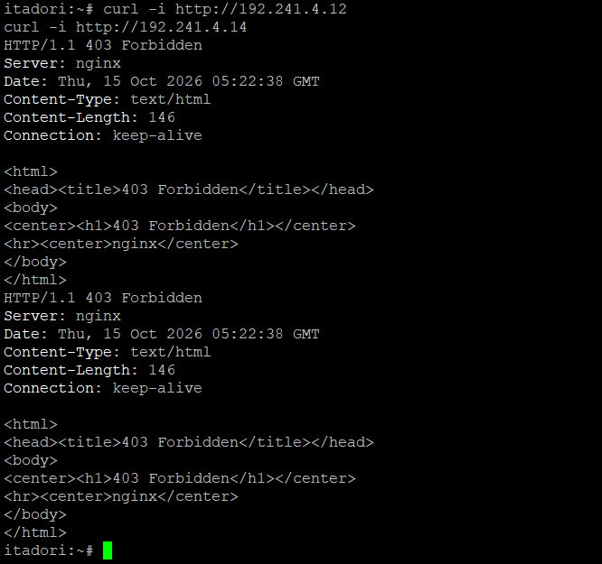

---

## Soal 15: Internal Load Balancer pada Geto (Weighted Round Robin 3:1)

### Deskripsi
Mengonfigurasi Nginx pada **Geto** (`192.241.4.11`) sebagai Internal Load Balancer dengan upstream `api_cluster` yang membagi beban trafik ke **Nanami** (`192.241.4.14`) dan **Todo** (`192.241.4.15`) menggunakan algoritma Weighted Round Robin dengan bobot `3:1`.

### 1. Script `/root` pada Server (**Geto** — `/root/soal15.sh`)
```bash
cat << 'EOF' > /root/soal15.sh
#!/bin/bash
ip addr add 192.241.4.11/24 dev eth0 2>/dev/null || true
ip link set eth0 up
ip route replace default via 192.241.4.1

if ! command -v nginx >/dev/null 2>&1; then
    echo "nameserver 192.168.122.1" > /etc/resolv.conf
    apt-get update && apt-get install -y nginx curl
fi

cat << 'EOT' > /etc/nginx/sites-available/geto_lb
upstream api_cluster {
    server 192.241.4.14:80 weight=3; # nanami
    server 192.241.4.15:80 weight=1; # todo
}

server {
    listen 80;
    server_name _;

    location / {
        proxy_pass http://api_cluster;
        proxy_set_header Host $host;
        proxy_set_header X-Real-IP $remote_addr;
        proxy_set_header X-Forwarded-For $proxy_add_x_forwarded_for;
    }
}
EOT

ln -sf /etc/nginx/sites-available/geto_lb /etc/nginx/sites-enabled/geto_lb
rm -f /etc/nginx/sites-enabled/default
nginx -t && service nginx restart
EOF

chmod +x /root/soal15.sh
/root/soal15.sh
```

### 2. Konfigurasi File Non-Root
* `/etc/nginx/sites-available/geto_lb`

### 3. Cara Pengujian & Hasil Verifikasi
Diuji dari jaringan lokal Data Center dengan mengirimkan loop request ke **Geto**:
```bash
for i in $(seq 1 8); do curl -s http://192.241.4.11/ | grep -o '"worker":"[^"]*"'; done
```
**Hasil Output:**
Dari 8 request beruntun, `"worker":"nanami"` merespons sebanyak **6 kali** dan `"worker":"todo"` merespons sebanyak **2 kali** (rasio distribusi beban tepat **3:1**).

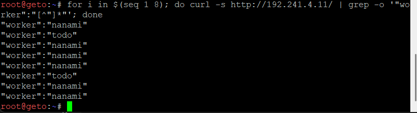

---

## Soal 16: Public Reverse Proxy pada Gojo (Path-Based Routing)

### Deskripsi
Mengonfigurasi Nginx pada **Gojo** (`192.241.1.4`) untuk melayani domain `jujutsu.k60.com` dan `www.jujutsu.k60.com` menggunakan metode *Path-Based Routing*:
* Request ke `/` diteruskan secara Round Robin ke worker frontend (**Maki** dan **Panda**).
* Request ke `/api` diteruskan ke internal load balancer **Geto** (`192.241.4.11`).

### 1. Script `/root` pada Server (**Gojo** — `/root/soal16.sh`)
```bash
cat << 'EOF' > /root/soal16.sh
#!/bin/bash
ip addr add 192.241.1.4/24 dev eth0 2>/dev/null || true
ip link set eth0 up
ip route replace default via 192.241.1.1

if ! command -v nginx >/dev/null 2>&1; then
    echo "nameserver 192.168.122.1" > /etc/resolv.conf
    apt-get update && apt-get install -y nginx curl
fi

cat << 'EOT' > /etc/nginx/sites-available/gojo_proxy
upstream frontend_cluster {
    server 192.241.4.12:80; # maki
    server 192.241.4.13:80; # panda
}

server {
    listen 80;
    server_name jujutsu.k60.com www.jujutsu.k60.com jujutsu.k-60.com www.jujutsu.k-60.com;

    location / {
        proxy_pass http://frontend_cluster;
        proxy_set_header Host $host;
        proxy_set_header X-Real-IP $remote_addr;
        proxy_set_header X-Forwarded-For $proxy_add_x_forwarded_for;
    }

    location /api {
        proxy_pass http://192.241.4.11/;
        proxy_set_header Host $host;
        proxy_set_header X-Real-IP $remote_addr;
        proxy_set_header X-Forwarded-For $proxy_add_x_forwarded_for;
    }
}
EOT

ln -sf /etc/nginx/sites-available/gojo_proxy /etc/nginx/sites-enabled/gojo_proxy
rm -f /etc/nginx/sites-enabled/default
nginx -t && service nginx restart
EOF

chmod +x /root/soal16.sh
/root/soal16.sh
```

### 2. Konfigurasi File Non-Root
* `/etc/nginx/sites-available/gojo_proxy`

### 3. Cara Pengujian & Hasil Verifikasi
Diuji dari client **Itadori** (`192.241.2.10`):
```sh
for i in 1 2 3 4; do curl -s http://jujutsu.k60.com/; done
for i in 1 2 3 4; do curl -s http://jujutsu.k60.com/api; done
```
**Hasil Output:**
```text
Halo dari Frontend Worker: maki
Halo dari Frontend Worker: panda
Halo dari Frontend Worker: maki
Halo dari Frontend Worker: panda
{"status":"success","worker":"nanami","client_ip":"192.241.1.4","db_log":"connected"}
{"status":"success","worker":"todo","client_ip":"192.241.1.4","db_log":"connected"}
{"status":"success","worker":"nanami","client_ip":"192.241.1.4","db_log":"connected"}
{"status":"success","worker":"nanami","client_ip":"192.241.1.4","db_log":"connected"}
```

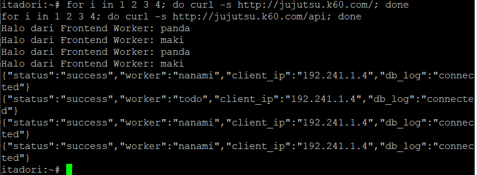

---

## Soal 17: Pelacakan IP Asli Klien (`X-Real-IP`, `X-Forwarded-For`, & Trusted Proxy)

### Deskripsi
Mengonfigurasi **Gojo** dan **Geto** agar meneruskan informasi IP asli klien melalui header `X-Real-IP` dan `X-Forwarded-For`. Memastikan **Geto** hanya mempercayai informasi alamat klien dari proxy terpercaya (**Gojo** `192.241.1.4` menggunakan `set_real_ip_from`), sehingga alamat yang tersimpan di kolom `client_ip` pada tabel `request_logs` di database **Yaga** adalah IP asli klien.

### 1. Script `/root` pada Server (**Geto** — `/root/soal17.sh`)
```bash
cat << 'EOF' > /root/soal17.sh
#!/bin/bash
cat << 'EOT' > /etc/nginx/sites-available/geto_lb
upstream api_cluster {
    server 192.241.4.14:80 weight=3; # nanami
    server 192.241.4.15:80 weight=1; # todo
}

server {
    listen 80;
    server_name _;

    set_real_ip_from 192.241.1.4;
    real_ip_header X-Forwarded-For;
    real_ip_recursive on;

    location / {
        proxy_pass http://api_cluster;
        proxy_set_header Host $host;
        proxy_set_header X-Real-IP $remote_addr;
        proxy_set_header X-Forwarded-For $proxy_add_x_forwarded_for;
    }
}
EOT

nginx -t && service nginx restart
EOF

chmod +x /root/soal17.sh
/root/soal17.sh
```

### 2. Konfigurasi File Non-Root
* `/etc/nginx/sites-available/geto_lb` (penambahan direktif `set_real_ip_from 192.241.1.4;` dan `real_ip_header X-Forwarded-For;`)
* `/var/www/api/index.php` pada Worker API (`$_SERVER['HTTP_X_REAL_IP'] ?? $_SERVER['REMOTE_ADDR']`)

### 3. Cara Pengujian & Hasil Verifikasi
1. Kirim request dari **Itadori** (Network 2 — `192.241.2.10`) dan **Kugisaki** (Network 3 — `192.241.3.99`):
   ```sh
   curl http://jujutsu.k60.com/api
   ```
2. Periksa catatan log di database **Yaga/Yoga** (`192.241.4.17`):
   ```bash
   mysql -u root -D db_shibuya_k60 -e "SELECT * FROM request_logs ORDER BY id DESC LIMIT 5;"
   ```
   **Hasil Output di Yaga/Yoga:**
   ```text
   +----+-------------+---------------+---------------------+
   | id | worker_name | client_ip     | created_at          |
   +----+-------------+---------------+---------------------+
   | 27 | nanami      | 192.241.3.99  | 2026-10-15 06:14:30 |
   | 26 | nanami      | 192.241.2.10  | 2026-10-15 06:14:20 |
   | 25 | nanami      | 192.241.1.4   | 2026-10-15 06:12:59 |
   | 24 | nanami      | 192.241.1.4   | 2026-10-15 06:12:59 |
   | 23 | todo        | 192.241.1.4   | 2026-10-15 06:12:59 |
   +----+-------------+---------------+---------------------+
   ```
   *(Terlihat jelas perbandingan sebelum Soal 17 [masih tercatat IP Gojo `192.241.1.4`] dan sesudah Soal 17 [tercatat IP asli klien `192.241.2.10` dan `192.241.3.99`]).*

   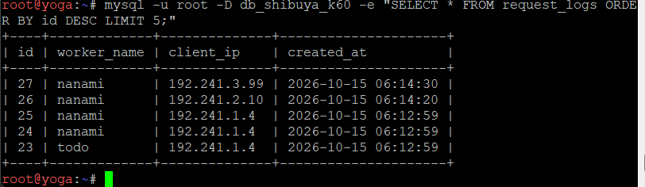

---

## Soal 18: Failover Worker API Cadangan (Kirara) & Passive Health Check

### Deskripsi
Mengonfigurasi upstream `api_cluster` pada **Geto** agar **Kirara** (`192.241.4.16`) menjadi server `backup`, serta menerapkan *passive health check* dengan parameter `max_fails=2` dan `fail_timeout=5s` pada worker API utama (**Nanami** dan **Todo**).

### 1. Script `/root` pada Server (**Geto** — `/root/soal18.sh`)
```bash
cat << 'EOF' > /root/soal18.sh
#!/bin/bash
cat << 'EOT' > /etc/nginx/sites-available/geto_lb
upstream api_cluster {
    server 192.241.4.14:80 weight=3 max_fails=2 fail_timeout=5s; # nanami (utama)
    server 192.241.4.15:80 weight=1 max_fails=2 fail_timeout=5s; # todo (utama)
    server 192.241.4.16:80 backup;                               # kirara (cadangan)
}

server {
    listen 80;
    server_name _;

    set_real_ip_from 192.241.1.4;
    real_ip_header X-Forwarded-For;
    real_ip_recursive on;

    location / {
        proxy_pass http://api_cluster;
        proxy_set_header Host $host;
        proxy_set_header X-Real-IP $remote_addr;
        proxy_set_header X-Forwarded-For $proxy_add_x_forwarded_for;
        proxy_next_upstream error timeout http_502 http_503 http_504;
    }
}
EOT

nginx -t && service nginx restart
EOF

chmod +x /root/soal18.sh
/root/soal18.sh
```

### 2. Konfigurasi File Non-Root
* `/etc/nginx/sites-available/geto_lb`

### 3. Cara Pengujian & Hasil Verifikasi
1. Hentikan layanan Nginx pada kedua worker utama (**Nanami** dan **Todo**):
   ```bash
   # Di Nanami & Todo:
   service nginx stop
   ```
2. Uji akses endpoint `/api` dari client **Itadori**:
   ```sh
   curl -i http://jujutsu.k60.com/api
   ```
   **Hasil Output di Itadori:**
   ```text
   HTTP/1.1 200 OK
   Server: nginx
   Date: Thu, 15 Oct 2026 06:19:06 GMT
   Content-Type: application/json
   Transfer-Encoding: chunked
   Connection: keep-alive

   {"status":"success","worker":"kirara","client_ip":"192.241.2.10","db_log":"connected"}
   ```
   *(Request berhasil dialihkan secara otomatis ke `kirara` dengan status `200 OK` tanpa mengalami error `502 Bad Gateway`. Setelah pengujian selesai, layanan Nginx pada Nanami dan Todo dinyalakan kembali dengan `service nginx start`).*

   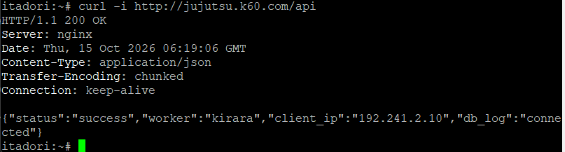

---

## Soal 19: Proxy Caching (`10m`) & Rate Limiting (`10r/s`) pada Gojo

### Deskripsi
Mengonfigurasi *Nginx Proxy Caching* pada **Gojo** untuk halaman web frontend (`/`) dengan masa berlaku cache 10 menit dan menambahkan header `X-Cache-Status`. Menerapkan *rate limiting* pada path `/api` dengan batas 10 request per detik per IP klien (`rate=10r/s`).

### 1. Script `/root` pada Server (**Gojo** — `/root/soal19.sh`)
```bash
cat << 'EOF' > /root/soal19.sh
#!/bin/bash
mkdir -p /var/cache/nginx/frontend_cache
chown -R www-data:www-data /var/cache/nginx/frontend_cache

cat << 'EOT' > /etc/nginx/sites-available/gojo_proxy
proxy_cache_path /var/cache/nginx/frontend_cache levels=1:2 keys_zone=FRONTEND_CACHE:10m max_size=100m inactive=10m use_temp_path=off;

limit_req_zone $binary_remote_addr zone=API_LIMIT:10m rate=10r/s;

upstream frontend_cluster {
    server 192.241.4.12:80; # maki
    server 192.241.4.13:80; # panda
}

server {
    listen 80;
    server_name jujutsu.k60.com www.jujutsu.k60.com jujutsu.k-60.com www.jujutsu.k-60.com;

    location / {
        proxy_cache FRONTEND_CACHE;
        proxy_cache_valid 200 10m;
        proxy_cache_key "$scheme$request_method$host$request_uri";
        add_header X-Cache-Status $upstream_cache_status always;

        proxy_pass http://frontend_cluster;
        proxy_set_header Host $host;
        proxy_set_header X-Real-IP $remote_addr;
        proxy_set_header X-Forwarded-For $proxy_add_x_forwarded_for;
    }

    location /api {
        limit_req zone=API_LIMIT;
        limit_req_status 429;

        proxy_pass http://192.241.4.11/;
        proxy_set_header Host $host;
        proxy_set_header X-Real-IP $remote_addr;
        proxy_set_header X-Forwarded-For $proxy_add_x_forwarded_for;
    }
}
EOT

nginx -t && service nginx restart
EOF

chmod +x /root/soal19.sh
/root/soal19.sh
```

### 2. Konfigurasi File Non-Root
* `/etc/nginx/sites-available/gojo_proxy`
* Direktori cache `/var/cache/nginx/frontend_cache` (milik user `www-data:www-data`)

### 3. Cara Pengujian & Hasil Verifikasi
1. **Pengujian Proxy Caching dari Itadori:**
   ```sh
   curl -I http://jujutsu.k60.com/
   curl -I http://jujutsu.k60.com/
   ```
   **Hasil Output:**
   ```text
   HTTP/1.1 200 OK
   Server: nginx
   Date: Thu, 15 Oct 2026 06:22:13 GMT
   Content-Type: text/html; charset=UTF-8
   Connection: keep-alive
   X-Cache-Status: MISS

   HTTP/1.1 200 OK
   Server: nginx
   Date: Thu, 15 Oct 2026 06:22:13 GMT
   Content-Type: text/html; charset=UTF-8
   Connection: keep-alive
   X-Cache-Status: HIT
   ```
   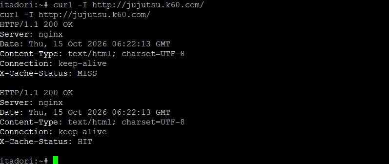

2. **Pengujian Rate Limiting `/api` dari Itadori:**
   ```sh
   for i in $(seq 1 20); do curl -s -o /dev/null -w "%{http_code}\n" http://jujutsu.k60.com/api & done; wait
   ```
   **Hasil Output:**
   Request awal yang masuk dalam kuota mendapatkan respons **`200`**, sedangkan 19 request paralel yang melampaui batas `10r/s` langsung ditolak dengan kode status **`429`** (*Too Many Requests*).
   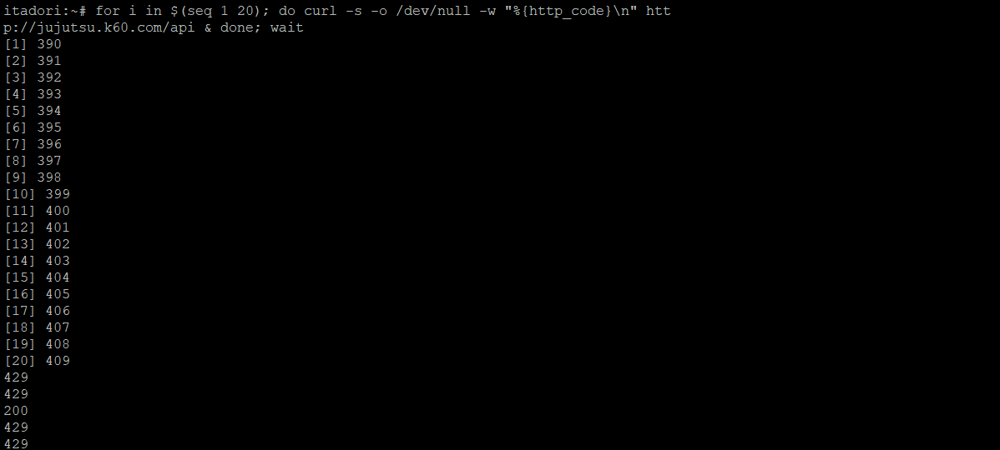

---

## Soal 20: Audit Kapasitas Layanan dengan Apache Benchmark (`ab`) & Analisis Log

### Deskripsi
Melakukan pengujian kapasitas dari terminal **Rusakabe (Kusakabe)** (`192.241.3.10`) menggunakan Apache Benchmark (`ab`) dengan parameter `-n 600 -c 30` menuju `http://jujutsu.k60.com/` dan `http://jujutsu.k60.com/api`, serta menganalisis `access.log` dan `error.log` pada **Gojo** untuk membedakan request sukses, kegagalan aplikasi/koneksi, dan request yang ditolak oleh kebijakan *rate limit*.

### 1. Script pada Client & Server

#### A. Node Client **Rusakabe / Kusakabe** (`/root/soal20.sh`)
*(Catatan: MAC Address `eth0` aktual pada container Rusakabe `f2:dd:ec:51:c9:cb` telah disinkronkan pada `/etc/dhcp/dhcpd.conf` di Tengen sehingga Rusakabe memperoleh lease `192.241.3.10` dengan lease time `1800` detik).*
```sh
cat << 'EOF' > /root/soal20.sh
#!/bin/sh
udhcpc -i eth0 -n -q -O 119

if ! command -v ab >/dev/null 2>&1; then
    apk update && apk add apache2-utils curl
fi

echo "=========================================="
echo "1. UJI BEBAN HALAMAN WEB UTAMA (/)"
echo "=========================================="
ab -n 600 -c 30 http://jujutsu.k60.com/

echo "=========================================="
echo "2. UJI BEBAN ENDPOINT API (/api)"
echo "=========================================="
ab -n 600 -c 30 http://jujutsu.k60.com/api
EOF

chmod +x /root/soal20.sh
/root/soal20.sh
```

#### B. Node Server **Gojo** (`/root/soal20_log.sh`)
```bash
cat << 'EOF' > /root/soal20_log.sh
#!/bin/bash
echo "=== RINGKASAN HTTP STATUS CODE DI ACCESS.LOG GOJO ==="
awk '{print $9}' /var/log/nginx/access.log | sort | uniq -c | sort -nr

echo ""
echo "=== JUMLAH REQUEST DITOLAK OLEH RATE LIMIT DI ERROR.LOG ==="
grep -c "limiting requests" /var/log/nginx/error.log || true

echo ""
echo "=== 5 LOG TERAKHIR RATE LIMIT DI ERROR.LOG ==="
grep "limiting requests" /var/log/nginx/error.log | tail -n 5 || true
EOF

chmod +x /root/soal20_log.sh
/root/soal20_log.sh
```

### 2. File Log Non-Root yang Dianalisis
* `/var/log/nginx/access.log` (pada Gojo)
* `/var/log/nginx/error.log` (pada Gojo)

### 3. Hasil Pengujian & Analisis Metrik

#### A. Ringkasan Perbandingan Metrik Apache Benchmark (`-n 600 -c 30`)

| Parameter Metrik | Halaman Utama (`/`) — *Proxy Cache Aktif* | Endpoint API (`/api`) — *Rate Limit `10r/s` Aktif* |
| ----- | ----- | ----- |
| **Concurrency Level** | `30` | `30` |
| **Time taken for tests** | `0.100 seconds` | `0.110 seconds` |
| **Complete requests** | `600` | `600` |
| **Requests per second (RPS)** | **`6010.04 [#/sec]`** | **`5440.94 [#/sec]`** |
| **Time per request (Mean)** | **`4.992 [ms]`** | **`5.514 [ms]`** |
| **Time per request (Concurrent)** | `0.166 [ms]` | `0.184 [ms]` |
| **Failed requests (Connect/Receive)** | `0` | `0` (Tidak ada kegagalan koneksi) |
| **Non-2xx responses (Rate Limited)** | **`0`** (100% `200 OK`) | **`598`** (598 ditolak `429`, 2 lolos `200 OK`) |

1. **Screenshot Hasil Benchmark Halaman Web Utama (`/`):**
   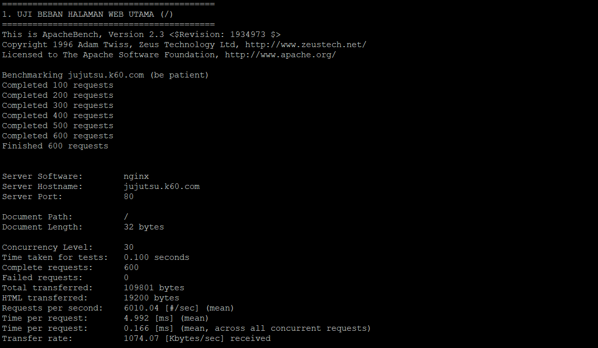

2. **Screenshot Hasil Benchmark Endpoint API (`/api`):**
   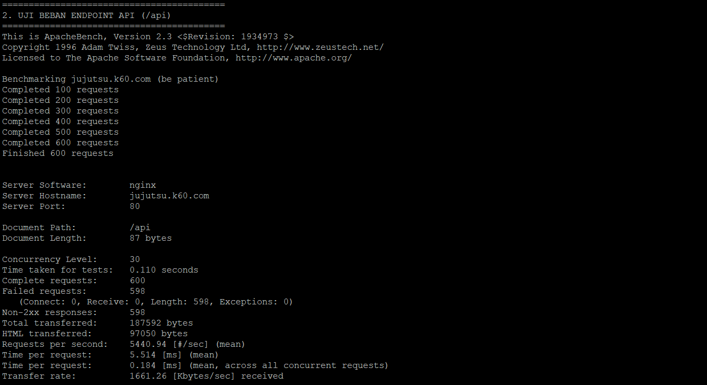

#### B. Hasil Analisis Access Log & Error Log pada Gojo
```text
=== RINGKASAN HTTP STATUS CODE DI ACCESS.LOG GOJO ===
    628 200
    617 429

=== JUMLAH REQUEST DITOLAK OLEH RATE LIMIT DI ERROR.LOG ===
617

=== 5 LOG TERAKHIR RATE LIMIT DI ERROR.LOG ===
2026/10/15 06:31:40 [error] 517#517: *1243 limiting requests, excess: 0.940 by zone "API_LIMIT", client: 192.241.3.10, server: jujutsu.k60.com, request: "GET /api HTTP/1.0", host: "jujutsu.k60.com"
2026/10/15 06:31:40 [error] 515#515: *1244 limiting requests, excess: 0.930 by zone "API_LIMIT", client: 192.241.3.10, server: jujutsu.k60.com, request: "GET /api HTTP/1.0", host: "jujutsu.k60.com"
```

3. **Screenshot Hasil Analisis Access Log & Error Log di Gojo:**
   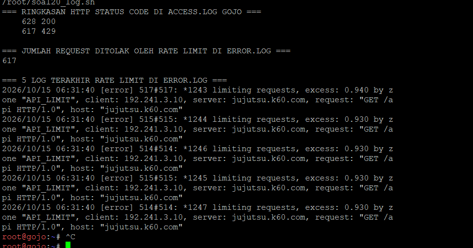

